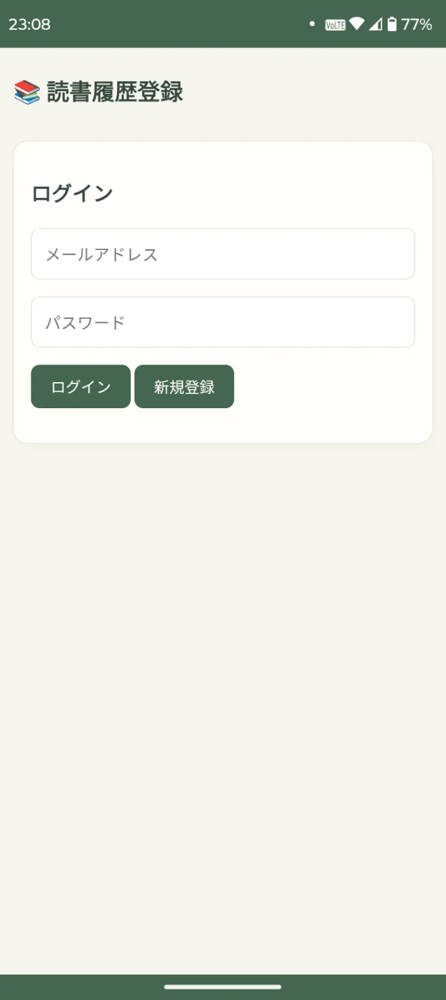

# 📚 My Little Library
### わたしの貸出履歴

## ■ アプリ概要
福岡市総合図書館で借りた本の履歴を管理するアプリです。
過去に借りた本をISBNで照合し、再び借りる際に確認できるようにしました。

## ■ 開発の背景・目的
図書館で本を借りる際、過去に読んだ本かどうかを確認できる仕組みがあれば便利だと考え、開発しました。

Chrome拡張機能とスマートフォン向けPWAを組み合わせ、場所や端末を問わず読書履歴を確認できることを目指しました。

## ■ 主な機能

### Chrome拡張機能
- 図書館の書籍ページからISBNを取得
- ISBN-10をISBN-13に変換
- 過去の貸出履歴との照合
- 前回の貸出日・貸出回数の表示

### スマートフォン向けPWA
- ユーザー登録・ログイン
- 書籍情報の登録・編集・削除
- ISBNバーコード読み取り
- 読書履歴の表示・検索
- PC版とのデータ共有

## ■ 使用技術
- HTML
- CSS
- JavaScript
- Firebase Authentication
- Cloud Firestore
- Firebase Hosting
- Chrome Extension Manifest V3
- PWA

## ■ 公開URL
https://my-book-history-d8b8e.web.app/

## ■ 開発環境
- macOS
- Visual Studio Code
- Google Chrome
- Node.js
- Git / GitHub

## ■ 今後の改善予定
- UI・操作性の改善
- 検索機能の拡充
- 機能の追加・改善

## ■ アプリ画面

### スマートフォン版

